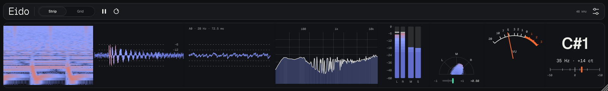
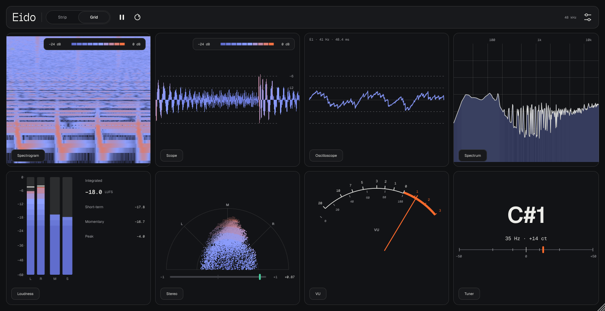
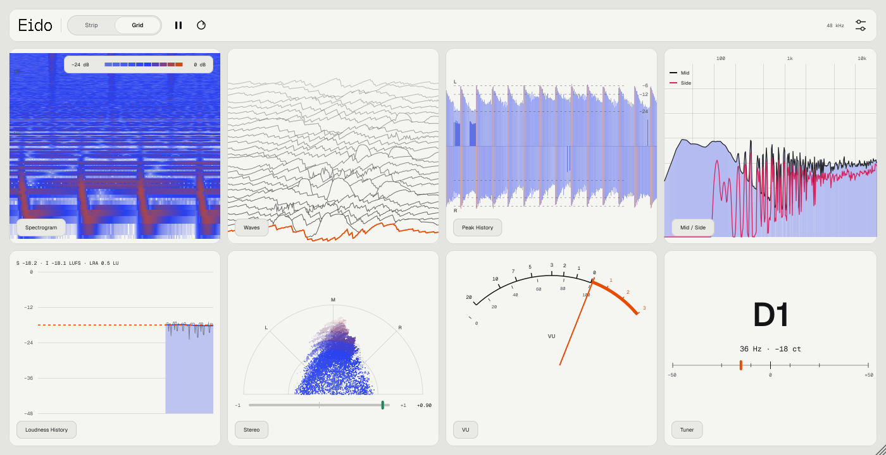

<p align="center">
  
</p>

<p align="center">
  
  
  
  
</p>

<p align="center">
  <a href="https://github.com/controloptioncommand/Eido-vst/releases/latest/download/Eido-macOS.zip"><b>⬇ Скачать Eido для macOS</b></a>
</p>

---

**Eido** — вайбкод-плагин: визуализатор и измеритель для мастер-канала или любой дорожки. Звук проходит без изменений, а вы смотрите на него восемью приборами сразу.

Брат синтезатора [Mist](https://github.com/controloptioncommand/Mist-vst): те же темы Oxygen и Rubber, те же шрифты Medeo и те же виды волны. Компоновка — в духе MiniMeters.

## Приборы

Двенадцать модулей в четырёх группах:

| Модуль | Что показывает |
|---|---|
| **Scope** | Плотная волна: полоска на каждый пиксель, цвет по громкости от −24 до 0 дБ, направляющие −6 и −12 дБ. |
| **Waves** | История волны «стопкой». Передняя линия — текущий момент. |
| **Oscilloscope** | Несколько периодов волны, синхронизированных по высоте тона: форма волны стоит на месте. |
| **Peak History** | Лента пиков и RMS во времени, L сверху, R снизу. Видно работу компрессора. |
| **Spectrum** | Спектр с наклоном 0 / 3 / 4.5 дБ на октаву. Под курсором — уровень, частота, нота и центы. |
| **Mid / Side** | Спектры середины и стороны на одном графике: на каких частотах звук широкий. |
| **Spectrogram** | Спектрограмма: по горизонтали время, по вертикали частота, цвет — громкость. |
| **Loudness** | Пики L / R с удержанием, Momentary и Short-term столбиками, Integrated в LUFS по EBU R128. |
| **Loudness History** | Громкость за последние 30 с, Integrated и LRA (диапазон громкости). |
| **VU** | Стрелочный VU-метр, 0 VU = −18 dBFS. |
| **Stereo** | Полярный стереометр и корреляция фаз от −1 до +1. |
| **Tuner** | Нота с октавой (C5, D2), частота целым числом (4853 Hz) и отклонение в центах. Эталон A4 — 432…444 Гц. |

Слотов восемь. Модуль можно **перетащить** мышью на другой слот — они поменяются местами. Стрелки **‹ ›** снизу справа сдвигают модуль, **▲** открывает меню, где его можно заменить любым другим и настроить. Раскладка сохраняется в проекте.

Integrated и LRA считаются прямо в аудиопотоке, поэтому продолжают копиться, даже когда окно плагина закрыто. Кнопка со стрелкой по кругу сбрасывает их вместе с пиками, пауза замораживает картинку.

Подробно о каждом модуле — в руководстве **[Eido-manual.pdf](docs/Eido-manual.pdf)**, оно же лежит в архиве релиза.

## Два режима окна

**Strip** — длинная полоса, как у MiniMeters. Удобно держать над треками.

**Grid** — окно как у Mist: сетка 4 × 2 из крупных модулей.

<p align="center">
  
</p>

Окно меняет размер как угодно, размер запоминается для каждого режима.

## Две темы

**Oxygen** — светлая, **Rubber** — тёмная. Можно следовать системной теме macOS или выбрать вручную: иконка настроек → Appearance. Один резкий оранжевый сигнальный цвет, плотные поверхности без стекла и теней. Интерфейс набран шрифтами Medeo: Sans, Mono для чисел и Pixel для логотипа.

<p align="center">
  
</p>

## Установка

1. Скачайте [Eido-macOS.zip](https://github.com/controloptioncommand/Eido-vst/releases/latest/download/Eido-macOS.zip) и распакуйте.
2. В Терминале: `bash ~/Downloads/Eido-macOS/install-mac.sh`
3. В Ableton: Settings → Plug-Ins → Rescan. Eido появится среди аудиоэффектов.

Плагин подписан ad-hoc (без Apple Developer ID), скрипт снимает карантин macOS.

## Сборка

```bash
cmake -B build -DEIDO_BUILD_TESTS=ON && cmake --build build --config Release --target Eido_VST3 Eido_AU EidoTest
```

JUCE 8 скачивается автоматически. Тест `EidoTest` проверяет громкость по эталонным сигналам, показания приборов и снимает скриншоты интерфейса.

Руководство в PDF собирается из `docs/manual/Eido-manual.html`: тест снимает свежие скриншоты, Chromium печатает PDF в `docs/Eido-manual.pdf` (нужны Python 3 с Pillow и Node.js с Playwright). Пересобирать при каждом изменении модулей, управления или поведения:

```bash
bash docs/manual/build.sh
```

## Лицензии

Шрифты Medeo — SIL Open Font License, см. `Resources/Fonts/OFL.txt`.
